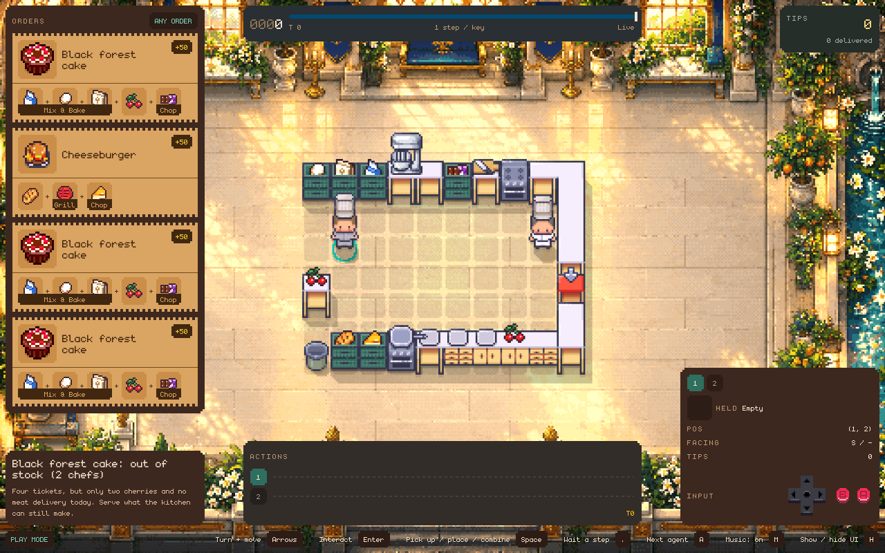

[English](README.md) | [简体中文](README.zh-CN.md)

# Too Many Chefs! 开放厨房挑战

一款受 Overcooked 启发的网格厨房游戏。厨师收集和加工食材、制作并交付菜品；可以使用键盘游玩，也可以编写控制器自动选择动作。



## 安装

先安装 [uv](https://docs.astral.sh/uv/getting-started/installation/)，在项目目录运行：

```bash
uv sync --extra fast-downward --extra native
uv run cook --help
```

如果平台不支持 fast-downward，可使用较慢但兼容性更好的规划器：

```bash
uv sync --extra pyperplan --extra native
```

再次运行 `uv sync` 时保留相同的 `--extra` 选项。

## 运行

手动游玩：

```bash
uv run cook play --level levels/demos/coconut_juice.yaml
```

观看控制器：

```bash
uv run cook agent --level levels/0_i_can_cook/0_0_coconut_juice_finished_on_counter.yaml
```

按空格开始。上述演示关卡中的果汁已经做好，控制器需要装盘并交付。

回放：

```bash
uv run cook replay --recording-path examples/recording.yaml
```

回放默认暂停，空格播放或暂停，左右方向键逐步移动。

## 键盘操作

| 按键 | 功能 |
| --- | --- |
| 方向键 | 转向和移动 |
| Enter | 使用面前的物品、加工食材或交付菜品 |
| Space | 拿起、放下或组合物品 |
| . | 等待一步 |
| M | 开关音乐 |
| H | 显示或隐藏面板 |

无法打开独立窗口时，终端会显示本地网页地址，在浏览器中打开即可。添加 `--no-window` 可始终使用浏览器；终端按 `Ctrl+C` 停止。

## 文档

- [安装与测试](docs/installation.md)
- [游玩、回放与智能体模式](docs/modes.md)
- [运行控制器](docs/agent-runs.md)
- [PDDL 规划器](docs/solvers.md)
- [命令行参考](docs/command-line.md)
- [编写关卡](docs/levels.md)

## 许可证

MIT，见 [LICENSE](LICENSE)。原始项目及真实贡献者的版权信息保留。
